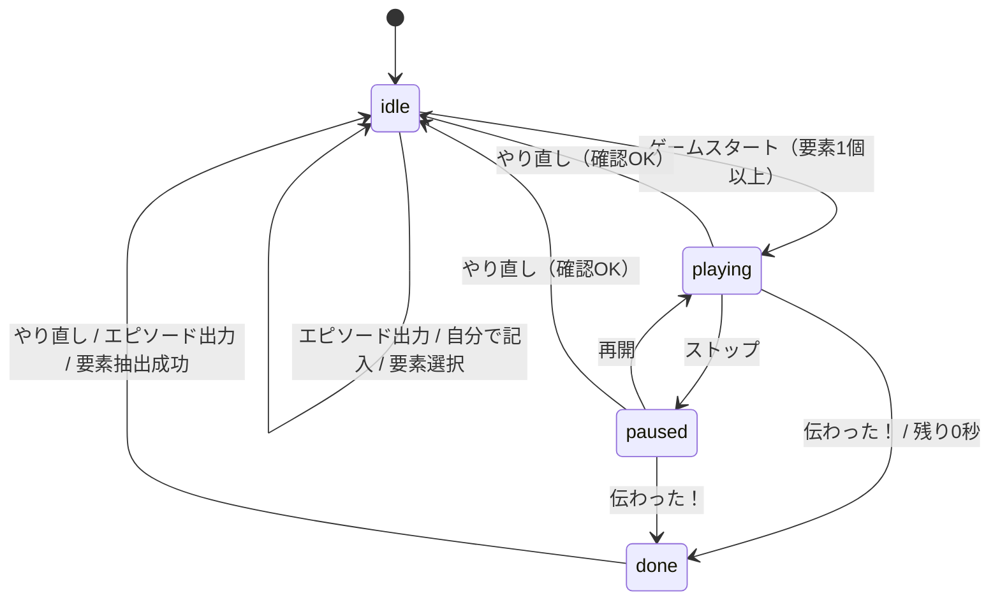

# 無言トーク 仕様書

本書は `index.html` / `episodes.js` / `episodes.json` の**現行実装の挙動**をもとに記述しています。

---

## 1. 概要

### コンセプト
「話し手」が**声を出さずに**（身ぶり・表情・動きだけで）エピソードトークを伝え、「聞き手」がどれだけ再現できたかを採点するパーティゲームです。
サブタイトル：「しゃべらずに、エピソードを伝えきれ。」

### プレイ人数の目安
話し手 1 人＋聞き手 1 人以上（2 人〜）。1 台の端末を全員で囲んで遊ぶ想定です。
※ 人数制限・人数設定の機能は実装にありません。

### 遊び方の要約
1. エピソード（導入・展開・結論の三部構成）を用意する（ランダム出題 or 自分で記入）。
2. 話し手がトーク要素（形容詞・動詞・名称・接続語）を 1〜4 個選ぶ。
3. 「ゲームスタート」で 3 分のタイマーが始まる。話し手は無言で伝える。選んだ要素カードはタップで読み上げられる（この要素だけは「音声」で補助できる）。
4. 聞き手（または採点者）は 3 本のスライダーで導入・展開・結論それぞれの再現度を 0〜100 で採点する。
5. 「伝わった！」を押すか時間切れで終了。3 本の平均点が点数ログに記録される。

---

## 2. ファイル構成

| ファイル | 役割 |
|---|---|
| `index.html` | 本体。HTML / CSS / JavaScript をすべて 1 ファイルに内包。 |
| `episodes.js` | エピソードデータ（20 本）。`window.EPISODES = [...]` を定義し、`<script src="episodes.js">` で読み込まれる。 |
| `episodes.json` | `episodes.js` と同内容の JSON 版。**`index.html` からは参照されていない**（データ編集・再利用用）。 |

- `episodes.js` を `<script>` タグで読む方式のため、`fetch` を使わず `file://` で直接開いても動作します。
- 外部依存は Google Fonts（Zen Kaku Gothic New / Zen Old Mincho）のみ。読めない場合は `system-ui` / `serif` にフォールバックします。

---

## 3. 画面構成

画面は縦 1 カラム（最大幅 860px）。上から順に以下のパネルが並びます。

### ヘッダー
- ロゴ（SVG）、タイトル「無言トーク」、サブタイトル
- **テーマ切替ボタン**（`◐ 自動` / `☀ ライト` / `☾ ダーク`）

### 3.1 エピソード欄（EPISODE）
| 要素 | 内容 |
|---|---|
| 🎲 エピソードを出力 | 収録エピソードからランダム出題 |
| ✏️ 自分で記入 | 記入フォームを開く |
| 🙈 本文を隠す / 👀 本文を表示 | プレイ中（playing / paused）のみ表示 |
| 記入フォーム（初期非表示） | 三行入力用テキストエリア、Claude API 設定（折りたたみ）、「✨ トーク要素を抜き出す」、「閉じる」、メッセージ欄 |
| エピソード表示 | タイトル、番号（収録作は `No.01` 形式、自作は `オリジナル`）、導入・展開・結論の 3 段。各段の右に**再現度メーター**（点数表示＋スライダー） |

未選択時はプレースホルダ「まだエピソードがありません」を表示。

### 3.2 トーク要素欄（TALK ELEMENTS）
- 凡例：形容詞（橙）／動詞（緑）／名称（青）／接続語（紫）
- 選択カウンタ `n / 4`
- **idle 時**：カテゴリごとに要素チップを並べる（要素が 0 個のカテゴリは見出しごと非表示）
- **playing / paused / done 時**：選んだ要素だけを大きな**プレイカード**として表示。「カードをタップすると読み上げます 🔊」

### 3.3 ゲーム欄（GAME）
| 要素 | 内容 |
|---|---|
| タイマー | 円形リング＋`m:ss` 表示。残り時間に応じてリングが減る |
| ステータス | 状態に応じたメッセージ（下表） |
| ▶ ゲームスタート | playing / paused 中は非表示。done 中は「▶ ゲームスタート（やり直しで次へ）」と表示され無効 |
| ⏸ ストップ / ▶ 再開 | playing / paused 中のみ表示 |
| 🙌 伝わった！ | playing / paused 中のみ表示 |
| 結果 | done 中のみ表示。「再現度の平均（導入・展開・結論）」、点数、ランク文言 |

ステータス文言：

| 状態 | 表示 |
|---|---|
| idle（エピソードなし） | 準備中／まずエピソードを用意しましょう |
| idle（要素 0 個） | 要素を選ぼう／要素を1つ以上（最大4つ）選ぶとスタートできます |
| idle（要素あり） | 準備OK／n個の要素を選択中。スタートで3分カウント開始 |
| playing | 🤐 無言で伝え中…／聞き手は右のバーで再現度を採点 |
| paused | ⏸ 一時停止中／もう一度押すと再開します |
| done | タイムアップ！／スコアを点数ログに記録しました |

※ 初期 HTML のステータスは「要素を1つ以上選ぶとスタートできます」ですが、起動時の描画で即座に上表の文言に置き換わります。

### 3.4 やり直し
- 「↺ やり直し」ボタン 1 つ。

### 3.5 点数ログ（SCORE LOG）
- 「今回話す人の名前」入力欄（最大 20 文字）
- ログ一覧（新しい順）
- 「ログを消去」ボタン

### フッター
「無言トーク — 声は出さずに、身ぶり・表情・動きだけで。」

---

## 4. ゲームの流れ

### 状態
内部状態 `phase` は `idle` / `playing` / `paused` / `done` の 4 つ。



### 状態ごとの操作可否

| 操作 | idle | playing | paused | done |
|---|---|---|---|---|
| エピソードを出力 / 自分で記入 / 要素を抜き出す | ○ | × | × | ○ |
| 要素チップの選択 | ○ | ―（カード表示） | ― | ― |
| ゲームスタート | 要素≥1で○ | 非表示 | 非表示 | 無効 |
| ストップ / 再開・伝わった！ | 非表示 | ○ | ○ | 非表示 |
| 再現度スライダー | 無効 | ○ | ○ | 無効 |
| 本文を隠す | 非表示 | ○ | ○ | 非表示 |
| 要素カードの読み上げ | ― | ○ | ○ | ○ |
| やり直し | ○ | 確認後○ | 確認後○ | ○ |

---

## 5. 機能詳細

### 5.1 ランダム出題
- `window.EPISODES` から一様ランダムに 1 本選ぶ。
- 収録数が 2 本以上のとき、**直前にランダム出題したエピソード（`id` 比較）と同じものは再抽選**して避ける。
  - 自作エピソード（`id: 0`）は「直前」の記録を更新しません。
- 出題時はゲーム状態をリセット（idle、スコア 0、本文表示、読み上げ停止）し、選択要素を空にします。
- 「エピソードを出力」を押すと記入フォームは閉じます。

### 5.2 自分で記入（Claude API による要素抽出）
1. 「自分で記入」で記入フォームを開く（メッセージ欄はクリア、テキストエリアにフォーカス）。
2. テキストエリアに**三行**で記入（1 行目＝導入、2 行目＝展開、3 行目＝結論）。
   - 行は改行（`\n` / `\r\n`）で分割し、各行を前後トリム、**空行は除外**して数える。
   - 3 行でなければ「エピソードは三行で書いてください（いまn行）。」とエラー表示し、送信しない。
3. API キーが空なら API 設定を開き「Claude API キーを入力してください。」と表示してキー欄にフォーカス。
4. 「✨ トーク要素を抜き出す」を押すとボタンを無効化し「⏳ Claude がトーク要素を抜き出しています…」を表示して Messages API を呼び出す。
   - `max_tokens: 1024`、system プロンプトで「指定の JSON のみ出力」を指示。
   - user プロンプトで以下を要求：adj 3〜4 個、verb 3〜4 個、noun 4〜5 個、conj 0〜3 個、すべて本文の部分文字列そのまま、重複なし、1 要素 1〜8 文字程度、title は 12 文字以内。
   - 出力形式：`{"title":"...","elements":{"adj":[],"verb":[],"noun":[],"conj":[]}}`
5. 応答処理：
   - `content` のうち `type: "text"` を連結し、最初の `{` から最後の `}` までを切り出して `JSON.parse`。
   - 各カテゴリについて、文字列化＋トリムし、**三行を連結した本文に含まれない要素を除外**、空文字と重複も除外。
   - 有効な要素の合計が 0 個ならエラー。
   - タイトルは `json.title`（なければ「わたしのエピソード」）を**先頭 12 文字**に切り詰め。
   - 成功時は自作エピソード（`id: 0`, `custom: true`）として設定し、「✅ n個のトーク要素を抜き出しました。下の欄から選んでください。」を表示。フォームは開いたまま。
6. エラー表示（メッセージ欄に赤字）：

| 条件 | 表示 |
|---|---|
| HTTP 401 | APIキーが正しくありません。 |
| その他 HTTP エラー | API エラー: （API のエラーメッセージ、なければ `HTTP ステータス`） |
| JSON 解析失敗（SyntaxError） | 応答の読み取りに失敗しました。もう一度試してください。 |
| 通信失敗（`Failed to fetch`） | API に接続できませんでした。通信環境を確認してください。 |
| 有効な要素が 0 個 | 本文に含まれる要素を抜き出せませんでした。文章を変えて試してください。 |
| その他 | エラーメッセージ、または「不明なエラーが発生しました。」 |

- 終了後、ボタンは playing / paused でなければ再度有効化。

### 5.3 API 設定
「🔑 Claude API 設定」（`<details>` 折りたたみ）内：

| 項目 | 仕様 |
|---|---|
| API キー | `type=password`、プレースホルダ `sk-ant-...` |
| キー保存チェック | 「このブラウザにキーを保存する（共有端末ではオフ推奨）」。オンにすると localStorage `mugon.apikey` に保存、オフにすると削除。オン中はキー欄の変更時・抽出実行時にも保存。起動時に保存済みキーがあればキー欄に入れてチェックをオンにする。 |
| モデル | `claude-haiku-4-5-20251001`（既定・先頭）／`claude-sonnet-5-5`／`claude-opus-5-5`。変更時に localStorage `mugon.model` に保存し、起動時に復元（不正値なら先頭を選択）。 |

リクエストヘッダ：

```
content-type: application/json
x-api-key: <APIキー>
anthropic-version: 2023-06-01
anthropic-dangerous-direct-browser-access: true
```

ブラウザから `https://api.anthropic.com/v1/messages` へ直接送信します（サーバー経由なし）。

### 5.4 要素選択
- idle 中のみ選択・解除可能（チップのトグル）。
- 選択数は **1〜4 個**（スタートには 1 個以上必要、上限 `MAX_PICK = 4`）。
- 4 個選ぶと、未選択のチップはすべて無効化（disabled）される。選択済みチップは解除可能。
- 要素は「カテゴリ＋文字列」の組で識別。選択順に保持され、プレイカードもこの順で並ぶ。
- **本文ハイライト**：選択中の要素文字列を本文中から検索し、カテゴリ色の下線＋太字で強調。
  - 長い文字列を優先してマッチ（正規表現の候補を長さ降順に並べる）。
  - 本文中の**すべての出現箇所**が対象（導入・展開・結論すべて）。
  - 同じ文字列が複数カテゴリで選ばれた場合、先にマップされたカテゴリの色を使う。

### 5.5 スタート条件
次をすべて満たすときのみ「ゲームスタート」が有効：
- エピソードが設定されている
- 要素が 1 個以上選択されている
- phase が `idle`

スタート時、スコアを `[0,0,0]`、残り時間を 180 秒にして playing へ遷移。

### 5.6 3 分タイマー
- 制限時間 `TIME_LIMIT = 180` 秒。
- 200ms 間隔の `setInterval` で、`performance.now()` を基準に終了予定時刻との差から残り時間を算出（タブ非アクティブ等で間隔が乱れても残り時間はずれない）。
- 表示は `m:ss`（秒は切り上げ）。リングは残り時間割合に応じて減少。
- 残り **30 秒以下**かつ playing 中は、数字が赤色で脈動（paused 中は停止）。
- 残り 0 秒で自動的に終了処理（5.8 と同じ `finish`）へ。

### 5.7 ストップ / 再開
- playing 中に「⏸ ストップ」：タイマー停止、残り時間を保持して paused へ。ボタンは「▶ 再開」に変わる。
- paused 中に「▶ 再開」：保持した残り時間から再開して playing へ。

### 5.8 伝わった！（終了処理）
playing / paused 中に押すと、時間切れと同じ終了処理を行う：
1. タイマー停止、残り時間を 0、phase を `done` に。
2. スコア計算（5.12）。
3. 終了音（Web Audio API、三角波 784Hz ×2 → 1046Hz ×1 の 3 音）。生成失敗時は無音で続行。
4. 点数ログへ記録（5.13）。
5. 結果欄に点数とランク文言を表示。

※ 経過時間・残り時間はログに記録されません。

### 5.9 読み上げ
- playing / paused / done 中、プレイカードをタップすると要素文字列を Web Speech API で読み上げる。
- `lang = 'ja-JP'`、`rate = 0.9`。音声一覧から `ja-JP`（なければ `ja` で始まるもの）の音声を選んで設定。音声一覧は `onvoiceschanged` で再取得。
- 読み上げ前に再生中の発話をキャンセル（連打しても重ならない）。
- 読み上げ中のカードは拡大・傾き表示。発話終了／エラー、または最長 2.5 秒で解除。
- 非対応端末ではステータス欄に「この端末は読み上げに対応していません」を約 2.2 秒表示。
- リセット時（出題・やり直し等）に読み上げを停止。

### 5.10 再現度スライダー
- 導入・展開・結論の各段に 1 本、計 3 本。
- 範囲 0〜100、**5 刻み**、初期値 0（スタート時にも 0 へリセット）。
- **playing / paused 中のみ操作可能**。idle / done では無効（メーターも半透明）。
  - 終了後に点数を修正することはできません。
- 操作に応じて点数表示とバーの塗りが即時更新。

### 5.11 本文を隠す
- playing / paused 中のみボタンが表示される。
- 押すと 3 段の本文にぼかし（blur 7px）をかけ、テキスト選択を禁止。再度押すと戻る。
- タイトル・段ラベル・スライダーは隠れない。
- 出題・やり直し等のリセット時に「表示」状態へ戻る。

### 5.12 スコア計算とランク
- スコア = 3 本のスライダー値の平均を `Math.round` で四捨五入（0〜100 の整数）。
- ランク文言：

| 点数 | 文言 |
|---|---|
| 90〜 | 🏆 以心伝心！ほぼ完全再現 |
| 70〜89 | 🎉 ばっちり伝わった！ |
| 50〜69 | 👍 だいたい伝わった |
| 30〜49 | 🤔 なんとなく伝わった…かも |
| 0〜29 | 😶 沈黙が深すぎた |

### 5.13 点数ログ
- 終了処理のたびに先頭へ 1 件追加（新しい順）。1 件の内容：

| キー | 内容 |
|---|---|
| `name` | 名前欄の値（トリム後）。空なら「ななしさん」 |
| `score` | 平均点 |
| `parts` | `[導入, 展開, 結論]` の各点 |
| `title` | エピソードタイトル |
| `elements` | 選択した要素文字列の配列 |
| `at` | 記録日時（ISO 8601） |

- **最大 100 件**。超えた分は古いものから削除。
- localStorage `mugon.log` に JSON で保存し、起動時に復元。
- 表示：通し番号（最古が 1）、名前入力欄、`タイトル ／ 要素・要素 ／ M/D HH:MM ／ 導n・展n・結n`、点数。
  - 日時が不正な場合は日時を省略、`parts` がない記録は各パート点を省略。
- **名前の後編集**：各記録の名前欄（最大 20 文字）を変更して確定（change イベント）すると保存。空にすると「ななしさん」。
- 名前入力欄（今回話す人）の値は localStorage `mugon.name` に保存・復元。
- 「ログを消去」：ログが 1 件以上あるとき確認ダイアログ「点数ログをすべて消去しますか？」で OK なら全消去。

### 5.14 やり直し
- playing / paused 中は確認ダイアログ「進行中のゲームを中断してやり直しますか？（スコアは記録されません）」を表示。キャンセルなら何もしない。
- 実行すると記入フォームを閉じ、**ランダム出題（5.1）を行う**（ゲーム状態リセット＋要素選択クリア）。
  - そのため自作エピソードで遊んでいても、やり直し後は収録エピソードに置き換わります。
  - 収録エピソードが 0 本の場合は、現在のエピソードのまま状態リセットと要素クリアのみ。
- playing / paused 中にページを離れようとするとブラウザ標準の離脱確認を出す（`beforeunload`）。

### 5.15 テーマ切替
- ボタンを押すたびに `自動 → ライト → ダーク → 自動` と巡回。
- 自動：OS の `prefers-color-scheme` に従う。ライト／ダーク：`<html data-theme>` で固定。
- localStorage `mugon.theme` に保存・復元。

### 5.16 localStorage キー一覧

| キー | 内容 |
|---|---|
| `mugon.log` | 点数ログ（配列） |
| `mugon.name` | 今回話す人の名前 |
| `mugon.apikey` | API キー（保存オン時のみ） |
| `mugon.model` | 選択モデル |
| `mugon.theme` | `auto` / `light` / `dark` |

---

## 6. データ仕様

### 6.1 スキーマ（episodes.json / episodes.js 共通）
ルートはエピソードオブジェクトの配列。

```json
{
  "id": 1,
  "title": "満員電車の悲劇",
  "parts": {
    "intro": "導入の本文",
    "development": "展開の本文",
    "conclusion": "結論の本文"
  },
  "elements": {
    "adj":  ["..."],
    "verb": ["..."],
    "noun": ["..."],
    "conj": ["..."]
  }
}
```

| フィールド | 型 | 説明 |
|---|---|---|
| `id` | number | 一意な番号（収録作は 1〜20）。直前回避と `No.xx` 表示に使用。自作は `0` |
| `title` | string | タイトル |
| `parts.intro` / `development` / `conclusion` | string | 導入・展開・結論の本文 |
| `elements.<cat>` | string[] | カテゴリ別トーク要素。すべて本文中に現れる文字列（収録 20 本で検証済み） |
| `custom` | boolean | 自作エピソードのみ実行時に付与（データファイルには無い） |

### 6.2 カテゴリ定義

| キー | 表示名 | 色（ライト） | 内容 |
|---|---|---|---|
| `adj` | 形容詞 | 橙 `#e9a23b` | 形容詞・形容動詞 |
| `verb` | 動詞 | 緑 `#3f8f6b` | 動詞（本文どおりの活用形） |
| `noun` | 名称 | 青 `#3b6fb0` | 名詞・物の名前 |
| `conj` | 接続語 | 紫 `#9b4f9e` | 接続詞・接続表現 |

### 6.3 収録エピソード一覧（20 本）

| No. | タイトル | 形容詞 | 動詞 | 名称 | 接続語 |
|---|---|---|---|---|---|
| 01 | 満員電車の悲劇 | 4 | 4 | 5 | 2 |
| 02 | 卵割りの失敗 | 4 | 4 | 5 | 2 |
| 03 | 会議に猫乱入 | 3 | 4 | 5 | 2 |
| 04 | 消えたパスポート | 4 | 4 | 5 | 3 |
| 05 | 特売の買いすぎ | 3 | 4 | 5 | 2 |
| 06 | 一夜漬けテスト | 3 | 4 | 5 | 2 |
| 07 | 奇跡のボウリング | 3 | 4 | 5 | 2 |
| 08 | 傘を忘れた日 | 4 | 4 | 5 | 2 |
| 09 | ロボット掃除機 | 3 | 4 | 5 | 2 |
| 10 | 温泉カラオケ | 4 | 4 | 5 | 3 |
| 11 | 映画館の悲劇 | 3 | 4 | 5 | 2 |
| 12 | サプライズ失敗 | 3 | 4 | 5 | 2 |
| 13 | 大寝坊の朝 | 3 | 4 | 5 | 2 |
| 14 | 美容院で別人 | 3 | 4 | 5 | 2 |
| 15 | 坂道の強敵 | 4 | 4 | 4 | 2 |
| 16 | 余ったネジ | 3 | 4 | 4 | 3 |
| 17 | 金魚すくい | 4 | 4 | 5 | 2 |
| 18 | スマホ行方不明 | 3 | 4 | 5 | 2 |
| 19 | カフェの呪文 | 4 | 4 | 5 | 2 |
| 20 | 父と大物釣り | 4 | 4 | 5 | 3 |

（数値は各カテゴリの要素数）

---

## 7. 非機能要件・注意事項

### 7.1 対応ブラウザ
- 最新の Chrome / Edge / Firefox / Safari（iOS Safari 含む）を想定。
- CSS の `color-mix()` を使用しているため、これに未対応の古いブラウザでは一部の配色（背景のドット柄、点線枠、読み上げ中カードの背景など）が反映されない。
- レスポンシブ：幅 560px 以下でメーター幅・タイマーサイズを縮小。ビューポートは `viewport-fit=cover`。
- 読み上げ・終了音は Web Speech API / Web Audio API に依存。非対応時は読み上げ不可メッセージ／無音で継続。

### 7.2 iOS Safari での読み上げ・音声の注意
- 読み上げはカードのタップ（ユーザー操作）から開始されるため、iOS の「ユーザー操作起点でのみ発話」制約を満たす。
- 端末に日本語音声が無い場合は `lang='ja-JP'` 指定のみで発話する（音声の品質・可否は端末依存）。
- 本体のサイレントスイッチや音量設定によっては音が出ないことがある。
- 終了音の `AudioContext` は「ゲームスタート」タップ時に生成・resume しておくため、時間切れによる自動終了でも iOS Safari で終了音が鳴る。

### 7.3 localStorage が使えない場合
- 読み書きはすべて `try/catch` で保護されており、例外でゲームが止まることはない。
- 読み込み失敗時は既定値（ログ空、名前空、テーマ自動、モデル先頭、キー未保存）で起動。
- 書き込み失敗時は保存されないだけで、点数ログ等はそのページを開いている間はメモリ上で保持・表示される（再読み込みで消える）。

### 7.4 episodes.js が読めない場合
- エピソード欄に「episodes.js が読み込めませんでした／index.html と同じフォルダに episodes.js を置いてください。「自分で記入」は使えます。」を表示。
- ランダム出題は何もしない。自分で記入（API 抽出）は利用可能。

### 7.5 API キーの取り扱い
- キーはブラウザから Anthropic API へ直接送信され、ページの配信元サーバーには送られない。
- 「保存する」をオンにすると localStorage に**平文**で保存される。共有端末・公開端末ではオフを推奨（UI 上にも明記）。
- ブラウザ直接アクセス用ヘッダ（`anthropic-dangerous-direct-browser-access`）を使うため、キーはページ利用者自身のものを入力する前提。公開ページにキーを埋め込まないこと。
- 利用料金は入力したキーの所有者に発生する。

---

## 8. 今後の拡張案
- プレイヤー登録とターン制（話し手を順番に回し、名前を自動入力）
- 「伝わった！」時の残り時間をログに残し、早く伝わるほどボーナス
- 制限時間・要素上限数を設定で変更可能に
- 点数ログの CSV 書き出し／プレイヤー別ランキング
- 自作エピソードの保存と再利用（API を再度呼ばずに遊べる）
